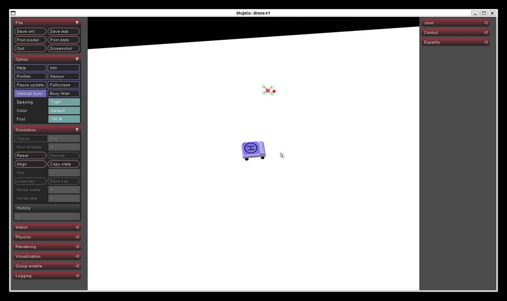
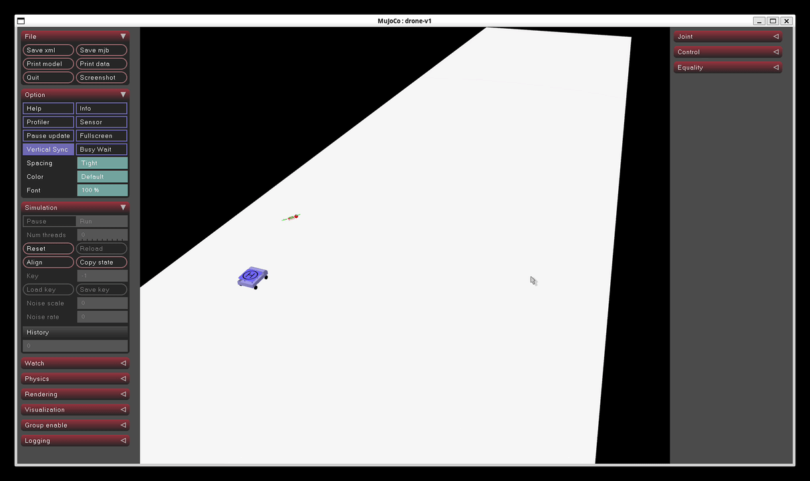
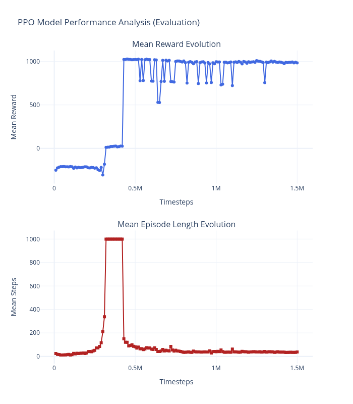
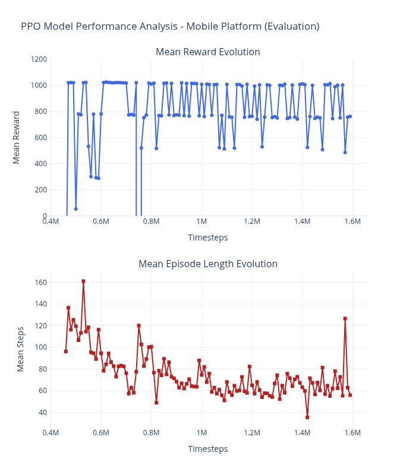

# 🚁 Drone Precision Landing on a Dynamic Mobile Platform using Deep Reinforcement Learning (PPO)

This project implements a complete Deep Reinforcement Learning framework to train and fine-tune an autonomous quadrotor drone capable of performing high-precision landings on a moving, dynamic platform within a MuJoCo physics simulation.

<br>
<p align="center">
  
  <br>
  <em>Demonstration 1: Autonomous landing on a Static Platform</em>
</p>
<br>

<p align="center">
  
  <br>
  <em>Demonstration 2: Autonomous landing on a Dynamic Mobile Platform</em>
</p>
<br>

---


## 🚀 Project Architecture & Roadmap

The project is structured into three progressive development phases, transitioning from theoretical physics validation to industrial simulation and robust deployment:

1. **Phase 1: Theoretical Foundations (`phase1_drone_physics/`)**
   - Custom 3D physics engine built purely in NumPy (Newton-Euler equations, PFD, TDM, Runge-Kutta 4 integrator, and quaternion kinematics).
   - Validation through a custom 3D Matplotlib visualizer and a basic hover control environment.

2. **Phase 2: Industrial Physics & MuJoCo Discovery (`phase2_mujocu_understanding/`)**
   - Integration of the MuJoCo physics engine via XML markup (`scene.xml`) for accurate contact dynamics, friction, and rigid body collisions.
   - First successful steps with static landing environments and Gymnasium wrappers.

3. **Phase 3: Fine-Tuning, Curriculum Learning & Robustness (`phase3_mujocu_improve_model/`)**
   - Transfer learning using pre-trained static baseline models[cite: 1, 2].
   - Advanced fine-tuning via Stable-Baselines3 (PPO) with custom evaluation and checkpoint callbacks (`EvalCallback`, `CheckpointCallback`)[cite: 1].
   - Domain randomization and variable platform velocities to ensure real-world robustness.

---

## 🏗️ Project File Structure

```text
Reinforcement_Learning/
│
├── documentation/                      # Performance analysis charts & documentation
│   ├── Training_stats_static_platform.png
│   └── Training_stats_mobile.png
│
├── phase1_drone_physics/               # Phase 1: Custom NumPy physics & visualizer
├── phase2_mujocu_understanding/        # Phase 2: MuJoCo discovery & static landing
│
└── phase3_mujocu_improve_model/        # Phase 3: Advanced Mobile Landing & PPO Fine-Tuning
    └── src/
        ├── env/                        # Custom Gymnasium environments
        │   ├── drone_env_static_platform.py
        │   └── drone_env_mobile_platform.py[cite: 1]
        ├── xmls/                       # MuJoCo XML physical models (drone & cart)
        ├── models/                     # Static baseline models & weights
        ├── models_mobile/              # Mobile fine-tuned models & checkpoints[cite: 1]
        ├── tb_logs/                    # TensorBoard logs (static training)
        ├── tb_logs_mobile/             # TensorBoard logs (mobile fine-tuning)[cite: 1]
        └── scripts/                    # Training, fine-tuning, and testing scripts
            ├── train_mobile_platform.py
            └── test_best_model_mobile_platform.py

```

---

## 🧠 Environment Specifications (`DroneLandingEnv`)

* **Observation Space (13 dimensions):**
  * Relative position $(X, Y, Z)$ normalized.


  * Relative linear velocity vector.


  * Drone orientation (Quaternion: $w, x, y, z$).


  * Drone angular velocities.


* **Action Space (4 dimensions):**
  * Continuous motor thrust commands for the four rotors.


  * **Dynamic Target:**
  * The platform starts at randomized positions and moves along unpredictable 2D sinusoidal trajectories with varying amplitudes, frequencies, and phases.


  * **Precision Success Criteria:**
  * **Horizontal Distance (`dist_xy`):** $< 0.10\text{ m}$ (center alignment).


  * **Vertical Distance (`dist_z`):** $< 0.05\text{ m}$.


  * **Relative Velocity (`vitesse_relative_norme`):** $< 0.20\text{ m/s}$ (soft touchdown).


  * **Orientation Alignment (`z_alignement`):** $> 0.90$.


---

## 💻 Installation & Prerequisites

1. Clone the repository and navigate to the project directory.
2. Create and activate a Python virtual environment:
```bash
python3 -m venv venv
source venv/bin/activate

```


3. Install the required dependencies:
```bash
pip install gymnasium mujoco stable-baselines3 numpy matplotlib

```


---

## 🏃‍♂️ Usage & Execution

### 1. Training / Fine-Tuning on Mobile Platform

To run fine-tuning on top of the pre-trained static model with strict precision metrics and custom callbacks:

```bash
cd phase3_mujocu_improve_model/src/scripts
python3 train_mobile_platform.py

```

NB: If you want the static training:

```bash
cd phase3_mujocu_improve_model/src/scripts
python3 train_static_platform.py

```

### 2. Testing & Visualization

To launch the interactive MuJoCo passive viewer and test the best-performing mobile landing model over multiple evaluation episodes (you can already use the last one I trained):


```bash
python3 test_best_model_mobile_platform.py

```
NB: If you want the static test : 

```bash
python3 test_best_model_static_platform.py
```

### 3. Monitoring Training via TensorBoard

To inspect reward convergence and episode length metrics:

```bash
tensorboard --logdir=phase3_mujocu_improve_model/src/tb_logs_mobile

```

---

## 📊 Performance & Results Analysis

* **Average Reward:** $\approx 1017.11 \pm 5.20$ during evaluation phases, validating consistent success across randomized dynamic trajectories.


* **Robustness:** The agent successfully generalizes to variable platform velocities without overfitting to specific trajectory paths.


## 📊 Performance & Results Analysis

- **Average Reward:** $\approx 1017.11 \pm 5.20$ during evaluation phases, validating consistent success across randomized dynamic trajectories.
- **Robustness:** The agent successfully generalizes to variable platform velocities without overfitting to specific trajectory paths.

### Training Evolution Curves

#### 1. Static Platform Baseline Training

The agent successfully converges toward a stable optimal reward score of 1000, establishing a solid baseline policy for precision landing.

<br>

<br><br>

#### 2. Dynamic Mobile Platform Fine-Tuning

Leveraging transfer learning, the agent adapts to sinusoidal moving targets, successfully recovering from trajectory variations and achieving robust landing behaviors.

<br> 

<br><br>
